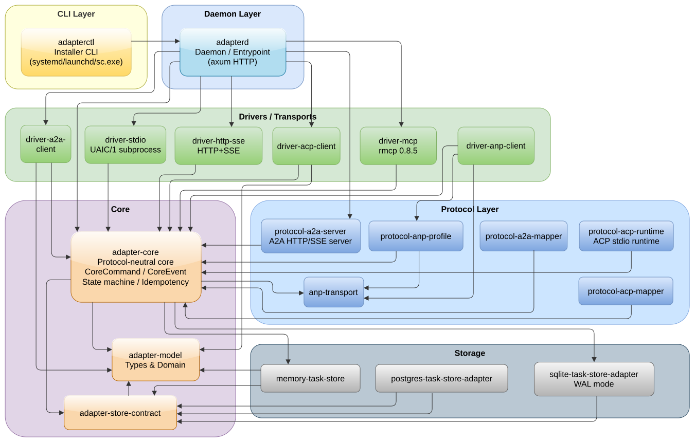

# μ Gate — Don't give your AI agent your wallet. Put a rule between them.

[](https://github.com/GG-QandV/agents-blockchain)
[](./LICENSE)
[](https://rust-lang.org)

**μ Gate** is a local daemon that controls AI-agent payments. The agent never sees the wallet key. The owner sets rules (daily budget, whitelist, per-resource price caps). Every decision and payment is logged in an append-only hash chain.

**Zero gas fees** for the owner — payments use [x402](https://github.com/coinbase/x402) (EIP-3009 `TransferWithAuthorization`) over USDC on Base.

---

## Quickstart (30 min)

### Prerequisites

- **Rust** ≥ 1.75 (`rustup install 1.75`)
- **Linux** or **macOS** (Unix socket transport; Windows via WSL2)
- **Python 3** for the CP1 test harness (optional)

### 1. Build & test

```bash
cd mu
cargo test --workspace --features mu-vault/softvault
cargo build -p mu-daemon --features softvault
```

### 2. Generate fixtures

```bash
export MU_HOME=/tmp/mu-gate
rm -rf $MU_HOME
cargo run -p mu-fixtures
```

### 3. Run the daemon (stub mode — no real payments)

```bash
./target/debug/mu-daemon
```

In another terminal:

```bash
python3 clients/mu-client.py /tmp/mu-daemon.sock \
  0x833589fCD6eDb6E08f4c7C32D4f71b54bdA02913 1000000 cp1-agent
```

### 4. Run CP1 (real payment proof — needs funded wallet)

```bash
# Fund wallet with $20 USDC on Base mainnet
MU_CONNECTOR=x402 MU_WALLET_ADDR=0x<your_address> ./target/debug/mu-daemon

# In another terminal:
python3 clients/cp1-harness.py
```

See `cp1-harness.py` for the 4 test cases (allowed call, wrong address denial, threshold test, log review).

---

## KSG edition — `0.2.0-ksg`

The `keysingate` line of μ Gate. An agent pays a keysingate issuer for a repeated
`bare`: the issuer answers `402 Payment Required`, and the payment goes through
Ω → Δ → owner's confirmation → WAL → the x402 connector → `X-PAYMENT`, which the
seller side (`ksg-pay-v2`) accepts.

What differs from 0.2.1:

- x402 connector rewritten against an independent EIP-712 implementation: the
  0.2.1 type-hash constants were wrong, so every signature was invalid;
- the 402 challenge must match the intent's recipient, amount, network, USDC
  contract and EIP-712 domain, with a validity of ≤ 1 h, or nothing is signed;
- the payer address is derived from the signing key; a key that is not the
  configured wallet signs nothing;
- policy may be loaded from `policy.toml`; EVM addresses are checked as EIP-55,
  Sui addresses are gone;
- `mu-license` crate, `ksg-smoke` binary, `ksg-bare-repeat` policy templates.

### `ksg-smoke`

Pays an issuer's 402 answer on Base Sepolia and prints the `X-PAYMENT` header:

```bash
cd mu
cargo build -p ksg-smoke
MU_PAYER_KEY_FILE=~/.secrets/keysingate/base-sepolia/payer.hex \
  ./target/debug/ksg-smoke < 402.json > x-payment.txt
```

Keys and limits are not compiled in:

| Env var | Default | Meaning |
| --- | --- | --- |
| `MU_PAYER_KEY_FILE` | test key `0x11…11` | payer key file, 64 hex, mode 600 |
| `MU_OWNER_KEY_FILE` | test key `0x02…02` | owner key file, same format |
| `MU_MAX_CEILING_MINOR` | `10000000` | Ω ceiling |
| `MU_DAILY_LIMIT_MINOR` | `5000000` | Δ daily limit |
| `MU_CONFIRM_THRESHOLD_MINOR` | `0` | owner confirmation threshold |
| `MU_MAX_PRICE_PER_CALL_MINOR` | `1000000` | per-resource price cap |

`master` is the main branch; the KSG line lives in `keysingate` and is merged
into `master` for release.

---

## Architecture



*Architecture diagram: [`diagram-1.svg`](diagram-1.svg) (source: [`docs/diagram-1.drawio`](docs/diagram-1.drawio))*

### Modules

| Crate                   | Role                                                      |
| ----------------------- | --------------------------------------------------------- |
| `mu-gate`               | M8 — unix socket, ed25519 auth, rate-limit, allowlist     |
| `mu-runtime`            | M6 — pipeline: Ω → Δ → [human] → WAL → execute            |
| `mu-connect` / `x402`   | M7x — x402 client (EIP-712, EIP-3009, self-check)         |
| `mu-connect` / `crypto` | M7a — EVM USDC connector (Base, legacy)                   |
| `mu-policy`             | M2/M3 — Ω (ceiling) + Δ (whitelist, budget, resources)    |
| `mu-log`                | M5 — append-only hash chain WAL, reconcile                |
| `mu-vault`              | M4 — k256/P-256 keys, soft vault (dev) / enclave (TBD)    |
| `mu-human`              | M9 — owner biometric confirmation dialog                  |
| `mu-core`               | M1 — μ-object format, CBOR-like serialization             |
| `mu-daemon`             | Binary — boot protocol, socket server, Runtime            |
| `mu-license`            | Ed25519-signed license check                              |
| `composer-core`         | C2 — Delta proposal encode/decode (offline policy change) |
| `composer-cli`          | C2 — CLI tool for whitelist/daily-limit management        |

---

## Configuration

### `policy.toml`

```toml
daily_limit_minor = 5_000_000_000        # 5000 USDC/day
confirm_threshold_minor = 100_000_000    # >100 USDC → owner confirms

[[whitelist]]
address = "0x833589fCD6eDb6E08f4c7C32D4f71b54bdA02913"
label = "CoinGecko x402"

[[resource_allowlist]]
host = "api.coingecko.com"
path_prefix = "/api/v3/simple/price"
max_price_per_call_minor = 1_000_000     # $1/call
```

Templates in `mu/policy-templates/`:

- `approved-recipients-only.toml`
- `daily-budget.toml`
- `approval-above-threshold.toml`
- `cp1-coingecko.toml`

### Environment

| Env var          | Default   | Description                                |
| ---------------- | --------- | ------------------------------------------ |
| `MU_CONNECTOR`   | `stub`    | `x402` for real payments                   |
| `MU_WALLET_ADDR` | —         | Wallet address (hex, with or without `0x`) |
| `MU_HOME`        | `/tmp/mu` | Fixtures directory                         |
| `MU_POLICY_SOCK` | —         | Unix socket path for Composer              |

---

## Clients

- **Python** — `mu/clients/mu-client.py` (run from `mu/` as `clients/mu-client.py`)
- **TypeScript** — `mu/clients/mu-client.ts`
- **CP1 harness** — `mu/clients/cp1-harness.py`

---

## License

**BSL 1.1** — Business Source License.

- **Personal use**: Free (full functionality)
- **Internal business use**: Free (see Additional Use Grant)
- **Competing product or SaaS**: Requires a commercial license
- **After 4 years (or Change Date 2030-07-15)**: Converts to Apache 2.0

See [LICENSE](./LICENSE) for full terms.
