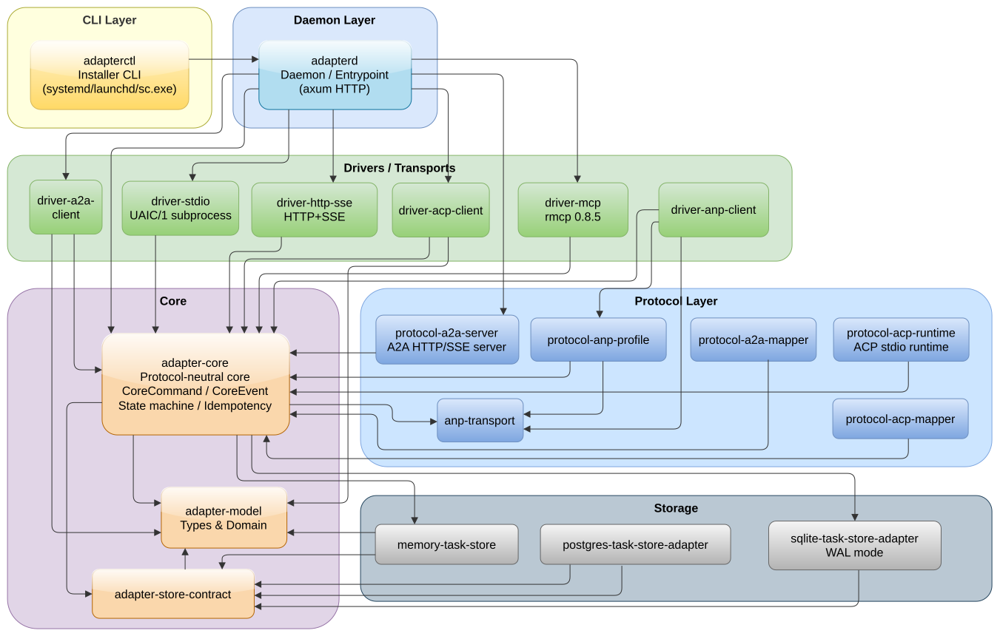

# μ Gate — Don't give your AI agent your wallet. Put a rule between them.

[](https://github.com/GG-QandV/agents-blockchain)
[](./LICENSE)
[](https://rust-lang.org)

**μ Gate** is a local daemon that controls AI-agent payments. The agent never sees the wallet key. The owner sets rules (daily budget, whitelist, per-resource price caps). Every decision and payment is logged in an append-only, signed hash chain — together with what was quoted (payee, price, resource, policy hash), so the log alone shows whether the gate held.

**Zero gas fees** for the owner — payments use [x402](https://github.com/coinbase/x402) (EIP-3009 `TransferWithAuthorization`) over USDC on Base.

---

## Quickstart (30 min)

Full key guide — create, use, store, back up: **[docs/KEYS.md](docs/KEYS.md)**.

### Prerequisites

- **Rust** ≥ 1.75 (`rustup install 1.75`)
- **Linux** or **macOS** (Unix socket transport; Windows via WSL2)
- **Python 3** + `pip install cryptography` for the sample agent client (optional)

### 1. Build & test

```bash
cd mu
cargo test --workspace --features mu-vault/softvault
cargo build --release -p mu-daemon -p mu-keygen --features mu-daemon/softvault
```

### 2. Create your keys (never ship or reuse someone else's)

```bash
./target/release/mu-keygen init ~/.mu-gate --limit 25 --threshold 25 \
  --allow 0x5aAeb6053F3E94C9b9A09f33669435E7Ef1BeAed=my-api
./target/release/mu-keygen check ~/.mu-gate
```

This writes the wallet, owner, μ and agent keys (random, mode 600), the first owner-signed μ object (your policy) and an empty log. The wallet address it prints is the one to fund. **Back the keys up before funding** — see [docs/KEYS.md](docs/KEYS.md).

### 3. Run the daemon (stub mode — no real payments)

```bash
MU_HOME=~/.mu-gate ./target/release/mu-daemon
```

In another terminal, as the agent (it holds only `agent.key`, never the wallet key):

```bash
python3 clients/mu-client.py /tmp/mu-daemon.sock \
  0x5aAeb6053F3E94C9b9A09f33669435E7Ef1BeAed 1000000 agent-1 --key ~/.mu-gate/agent.key
```

A recipient that is not on your whitelist, or an amount over the daily limit, comes back as a denial (`0x11`). The decision and what was quoted are in `~/.mu-gate/log.mulog`.

### Dev fixtures (public test keys — never fund them)

`cargo run -p mu-fixtures` creates a throwaway home with **publicly known** test seeds, used only by the test suite. Anything sent to its wallet can be taken by anyone.

### Real x402 payments

`MU_CONNECTOR=x402` makes the daemon sign EIP-3009 authorizations with `wallet.key` (the connector checks the 402 challenge against the approved intent). The daemon does not yet hand the signed authorization back to the agent, and the owner-confirmation dialog is a stub that denies; the end-to-end paying flow is `ksg-smoke` (see `mu/CHANGELOG-ksg.md`, live on Base Sepolia with `MU_PAYER_KEY_FILE`).

---

## Architecture



*Architecture diagram: [`diagram-1.svg`](diagram-1.svg) (source: [`docs/diagram-1.drawio`](docs/diagram-1.drawio))*

### Modules

| Crate                   | Role                                                      |
| ----------------------- | --------------------------------------------------------- |
| `mu-gate`               | M8 — unix socket, ed25519 auth, rate-limit, allowlist     |
| `mu-runtime`            | M6 — pipeline: Ω → Δ → [human] → WAL → execute            |
| `mu-connect` / `x402`   | M7x — x402 client (EIP-712, EIP-3009, self-check)         |
| `mu-connect` / `crypto` | M7a — EVM USDC connector (Base, legacy)                   |
| `mu-policy`             | M2/M3 — Ω (ceiling) + Δ (whitelist, budget, resources)    |
| `mu-log`                | M5 — append-only hash chain WAL, reconcile                |
| `mu-vault`              | M4 — k256/P-256 keys, soft vault (dev) / enclave (TBD)    |
| `mu-human`              | M9 — owner biometric confirmation dialog                  |
| `mu-core`               | M1 — μ-object format, CBOR-like serialization             |
| `mu-daemon`             | Binary — boot protocol, socket server, Runtime            |
| `mu-keygen`             | Binary — creates keys + first μ object (`init`/`show`/`check`) |
| `mu-license`            | Ed25519-signed license check                              |
| `composer-core`         | C2 — Delta proposal encode/decode (offline policy change) |
| `composer-cli`          | C2 — CLI tool for whitelist/daily-limit management        |

---

## Audit log

Checks run **before** the key is loaded: quote → Ω (ceiling) → Δ (whitelist, window, resource price cap) → human threshold → WAL → sign. For x402 the connector re-checks the 402 challenge (payee, amount, token, network) against the approved intent inside `execute`, right before signing (`mu-connect/src/x402.rs`).

Each intent leaves a chain of entries joined by `intent_hash`:

| Outcome | Entries |
| ------- | ------- |
| Paid    | `Quoted` → [`HumanDecision`, above the threshold] → `Pending` → `Settled` (or `Failed`; unresolved ones stay `Pending` until reconcile) |
| Denied  | `Quoted` → `DeniedOmega`/`DeniedDelta` → `DenyReason`; owner refusal/timeout: `Quoted` → `HumanDecision` → `DenyReason` |

Exception: if the connector cannot quote, there is nothing to record — `DeniedOmega` → `DenyReason` (`QUOTE_FAILED`) only.

- `Quoted` — recipient, chain, connector (the asset is that connector's per-network USDC constant, not a separate field), amount, gas estimate, x402 resource, and the hash of the Ω/Δ in force.
- `DenyReason` — which rule fired (`deny::*`), the total checked and the cap it met.
- No `Quoted` record, no payment: if it cannot be written, the intent fails before any money moves.
- After money has moved, a `Settled`/`Failed` that cannot be written is retried and queued, not dropped; until it lands, new intents are refused and the open `Pending` keeps holding the reserve.

`policy_hash` pins Ω (ceiling, connector set) and Δ (daily limit, threshold, whitelist, resource rules). It does not cover the 24h window length, the human timeout or the owner key. A reader with the log and the policy re-derives each verdict (see `mu/mu-runtime/tests/audit_trail.rs`, rung 4). The recipient is stored in clear; if you publish a log, hash it first — at the cost of that recomputation for third parties. Logs written before this change have no `Quoted`/`DenyReason` entries: the chain still verifies, but their verdicts cannot be re-derived. `intent_hash` now also covers connector and resource, so hashes differ from older logs for the same payee/amount.

---

## Configuration

### `policy.toml`

```toml
daily_limit_minor = 5_000_000_000        # 5000 USDC/day
confirm_threshold_minor = 100_000_000    # >100 USDC → owner confirms

[[whitelist]]
address = "0x833589fCD6eDb6E08f4c7C32D4f71b54bdA02913"
label = "CoinGecko x402"

[[resource_allowlist]]
host = "api.coingecko.com"
path_prefix = "/api/v3/simple/price"
max_price_per_call_minor = 1_000_000     # $1/call
```

Templates in `mu/policy-templates/`:

- `approved-recipients-only.toml`
- `daily-budget.toml`
- `approval-above-threshold.toml`
- `cp1-coingecko.toml`

### Environment

| Env var          | Default                | Description                                                   |
| ---------------- | ---------------------- | ------------------------------------------------------------- |
| `MU_HOME`        | — (required)           | Directory made by `mu-keygen init`: keys, `mu.bin`, `log.mulog` |
| `MU_SOCK`        | `/tmp/mu-daemon.sock`  | Unix socket the agent connects to                             |
| `MU_CONNECTOR`   | `stub`                 | `x402` for real authorizations                                |
| `MU_X402_NETWORK`| `base`                 | `base` (real money) or `base-sepolia`                         |
| `MU_WALLET_ADDR` | derived from the key   | Optional; if set it must equal the wallet of `wallet.key`     |
| `MU_POLICY_SOCK` | —                      | Unix socket path for Composer                                 |

---

## Clients

- **Python** — `mu/clients/mu-client.py`
- **TypeScript** — `mu/clients/mu-client.ts`
- **CP1 harness** — `mu/clients/cp1-harness.py`

---

## License

**BSL 1.1** — Business Source License.

- **Personal use**: Free (full functionality)
- **Internal business use**: Free (see Additional Use Grant)
- **Competing product or SaaS**: Requires a commercial license
- **After 4 years (or Change Date 2030-07-15)**: Converts to Apache 2.0

See [LICENSE](./LICENSE) for full terms.
